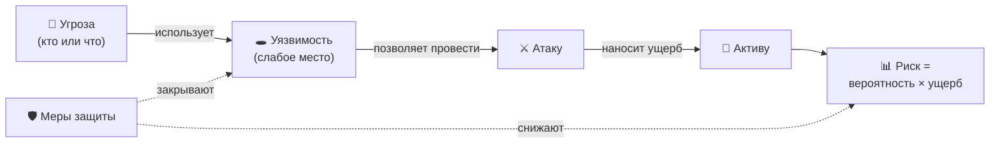

[🏠 Главная](../README.md) › [⚠️ Угрозы](README.md) › 🧭 Базовые понятия

# 🧭 Базовые понятия

Пять слов, без которых в ИБ не разобраться: **актив**, **угроза**, **уязвимость**, **атака** и **риск**.

## Содержание

- [Пять ключевых слов](#пять-ключевых-слов)
- [Как они связаны](#как-они-связаны)
- [Триада CIA](#триада-cia)
- [Кто атакует](#кто-атакует)
- [Вектор и поверхность атаки](#вектор-и-поверхность-атаки)
- [Источники](#источники)

---

## Пять ключевых слов

| Термин | Простыми словами | Пример из жизни | Пример из ИБ |
|---|---|---|---|
| **[Актив](../glossary.md#asset)** | То, что ценно и что надо защищать | Квартира и вещи в ней | База клиентов, сайт, ноутбук директора |
| **[Угроза](../glossary.md#threat)** | То, что может навредить активу | Квартирный вор | Хакерская группировка, шифровальщик |
| **[Уязвимость](../glossary.md#vulnerability)** | Слабое место, через которое можно навредить | Незапертая форточка | Необновлённая программа, пароль `123456` |
| **[Атака](../glossary.md#attack)** | Попытка реализовать угрозу через уязвимость | Вор лезет в форточку | Хакер взламывает сервер через ошибку в ПО |
| **[Риск](../glossary.md#risk)** | Насколько вероятен вред и насколько он велик | «Вероятно ли, что обворуют, и сколько я потеряю?» | «Взлом вероятен, ущерб до 10 млн ₽» |

**[Эксплойт](../glossary.md#exploit)** — это программа или приём, который использует конкретную уязвимость. Если уязвимость — незапертая форточка, то эксплойт — способ через неё пролезть.

**[Уязвимость нулевого дня (0-day)](../glossary.md#zero-day)** — уязвимость, о которой производитель ещё не знает или для которой ещё нет исправления. Название значит, что у защитников было «ноль дней» на подготовку.

> [!NOTE]
> В международной практике риск часто описывают формулой **риск = вероятность × ущерб**. Это упрощение, но оно хорошо показывает суть: опасна и частая мелкая угроза, и редкая катастрофическая. [[NIST SP 800-30 Rev. 1]](https://csrc.nist.gov/pubs/sp/800/30/r1/final)

---

## Как они связаны

Главное, что следует из схемы:

- **Угрозы почти никогда не устранить.** Хакеры, пожары и ошибки людей будут всегда.
- **Уязвимости можно закрыть.** Обновить ПО, включить второй фактор, обучить сотрудников.
- **Риск можно снизить.** Это и есть цель информационной безопасности.

---

## Триада CIA

Любая угроза в итоге нарушает хотя бы одно из трёх свойств информации. Вместе их называют **[триадой CIA](../glossary.md#cia)** (по первым буквам английских слов). [[NIST SP 800-12 Rev. 1]](https://csrc.nist.gov/pubs/sp/800/12/r1/final)

| | Свойство | Вопрос | Как нарушают |
|:-:|---|---|---|
| 🔒 | **[Конфиденциальность](../glossary.md#confidentiality)** (Confidentiality) | Видят ли данные только те, кому положено? | Утечка базы, перехват трафика, подглядывание через плечо |
| ✅ | **[Целостность](../glossary.md#integrity)** (Integrity) | Не изменили ли данные без разрешения? | Подмена реквизитов в счёте, изменение записей в базе |
| ⏱️ | **[Доступность](../glossary.md#availability)** (Availability) | Можно ли получить данные, когда они нужны? | DDoS, шифровальщик, сгоревший сервер |

В российских нормативных документах используются те же три свойства. ГОСТ Р 50922-2006 определяет безопасность информации как состояние, при котором обеспечены её конфиденциальность, доступность и целостность. [[ГОСТ Р 50922-2006]](https://docs.cntd.ru/document/1200058320)

---

## Кто атакует

Злоумышленника в ИБ называют **[нарушителем](../glossary.md#threat-actor)** (англ. *threat actor*). Нарушители различаются по мотивам и возможностям:

| Тип | Мотив | Возможности | Пример |
|---|---|---|---|
| 🧒 **Хулиганы-одиночки** | Любопытство, самоутверждение | Низкие, готовые инструменты | Взлом школьного сайта |
| 💰 **Киберпреступники** | Деньги | От низких до высоких, есть «рынок услуг» | Шифровальщики, кража банковских карт |
| 📢 **[Хактивисты](../glossary.md#hacktivism)** | Политика, идеология | Обычно средние | DDoS госсайтов, «слив» данных |
| 🏛️ **Государственные группировки ([APT](../glossary.md#apt))** | Шпионаж, диверсии | Очень высокие | Кибершпионаж, атаки на энергетику |
| 🕵️ **[Инсайдеры](../glossary.md#insider)** | Деньги, обида, ошибка | Уже имеют доступ изнутри | Сотрудник уносит базу клиентов |
| 🏢 **Конкуренты** | Коммерческая выгода | Нанимают других | Промышленный шпионаж |

Методика ФСТЭК тоже делит нарушителей на внешних и внутренних и оценивает их возможности по уровням от базовых до высоких. [[Методика ФСТЭК 2021]](https://www.consultant.ru/document/cons_doc_LAW_378330/)

---

## Вектор и поверхность атаки

- **[Вектор атаки](../glossary.md#attack-vector)** — путь, которым злоумышленник проникает в систему. Например, письмо с вложением, уязвимый сайт, флешка.
- **[Поверхность атаки](../glossary.md#attack-surface)** — все возможные точки входа вместе: открытые порты, сайты, сотрудники с почтой, подрядчики с доступом. Чем больше поверхность, тем больше у атакующего вариантов.

> [!TIP]
> Один из главных принципов защиты — **уменьшать поверхность атаки**: отключать ненужные сервисы, удалять старые учётные записи, не выставлять в интернет лишнего.

---

## Источники

- [ГОСТ Р 50922-2006. Защита информации. Основные термины и определения](https://docs.cntd.ru/document/1200058320)
- [NIST SP 800-30 Rev. 1. Guide for Conducting Risk Assessments](https://csrc.nist.gov/pubs/sp/800/30/r1/final)
- [NIST SP 800-12 Rev. 1. An Introduction to Information Security](https://csrc.nist.gov/pubs/sp/800/12/r1/final)
- [NIST Glossary](https://csrc.nist.gov/glossary)
- [Методика оценки угроз безопасности информации, ФСТЭК России, 2021](https://www.consultant.ru/document/cons_doc_LAW_378330/)

---

[← Обзор угроз](README.md) · [🏠 Главная](../README.md) · [Далее: 🦠 Вредоносное ПО →](01-malware.md)

