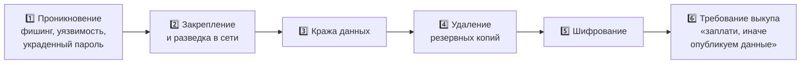

[🏠 Главная](../README.md) › [⚠️ Угрозы](README.md) › 🦠 Вредоносное ПО

# 🦠 Вредоносное ПО

**[Вредоносное ПО](../glossary.md#malware)** (англ. *malware*, от *malicious software*) — любая программа, которая делает на устройстве то, чего не хочет его владелец: крадёт, шифрует, удаляет, шпионит, захватывает управление.

## Содержание

- [Как вредонос попадает на устройство](#как-вредонос-попадает-на-устройство)
- [Типы вредоносного ПО](#типы-вредоносного-по)
- [Шифровальщики подробнее](#шифровальщики-подробнее)
- [Реальные случаи](#реальные-случаи)
- [Как защититься](#как-защититься)
- [Источники](#источники)

---

## Как вредонос попадает на устройство

| Путь | Пример |
|---|---|
| 📧 Вложение или ссылка в письме | «Счёт на оплату.pdf.exe», макрос в документе Word |
| 🌐 Заражённый или поддельный сайт | **[Drive-by-загрузка](../glossary.md#drive-by)**: заражение при простом посещении страницы |
| 💿 «Взломанные» программы и игры | Кряки и активаторы со встроенным трояном |
| 🔌 Флешки и другие носители | Вредонос запускается при подключении |
| 🕳️ Уязвимость в ПО | Червь сам проникает через незакрытую дыру |
| 📦 Обновление легальной программы | Атака через [цепочку поставок](06-supply-chain.md) |

[[MITRE ATT&CK: Initial Access]](https://attack.mitre.org/tactics/TA0001/)

---

## Типы вредоносного ПО

Типы различают по двум признакам: **как вредонос распространяется** и **что он делает**. Одна программа часто сочетает несколько типов. Например, WannaCry был одновременно червём и шифровальщиком.

### По способу распространения

| Тип | 💡 Простыми словами | ⚙️ Как работает |
|---|---|---|
| **[Вирус](../glossary.md#virus)** | Паразит внутри других файлов | Внедряет свой код в программы или документы и запускается вместе с ними. Сам не распространяется, нужен человек, который откроет файл |
| **[Червь](../glossary.md#worm)** | Размножается сам | Сам ищет в сети уязвимые компьютеры и копирует себя на них без участия человека. Распространяется очень быстро |
| **[Троян](../glossary.md#trojan)** | Волк в овечьей шкуре | Притворяется полезной программой (игрой, «обновлением», утилитой). Пользователь сам его устанавливает |

### По тому, что делает

| Тип | 💡 Что делает | 🎯 Что нарушает |
|---|---|:-:|
| **[Шифровальщик](../glossary.md#ransomware)** (ransomware) | Шифрует файлы и требует выкуп за ключ расшифровки | ⏱️ 🔒 |
| **[Вайпер](../glossary.md#wiper)** (wiper) | Безвозвратно уничтожает данные. Иногда маскируется под шифровальщика | ⏱️ ✅ |
| **[Стилер](../glossary.md#infostealer)** (infostealer) | Крадёт пароли, **[cookie](../glossary.md#cookie)**, данные карт и криптокошельки из браузера и программ | 🔒 |
| **[Шпионское ПО](../glossary.md#spyware)** (spyware) | Тайно следит: переписка, геолокация, микрофон, камера | 🔒 |
| **[Кейлоггер](../glossary.md#keylogger)** (keylogger) | Записывает всё, что набирается на клавиатуре, включая пароли | 🔒 |
| **[RAT](../glossary.md#rat)** (Remote Access Trojan) | Даёт злоумышленнику полное удалённое управление компьютером | 🔒 ✅ ⏱️ |
| **[Бэкдор](../glossary.md#backdoor)** (backdoor, «чёрный ход») | Скрытый способ входа в систему в обход защиты | 🔒 ✅ |
| **[Руткит](../glossary.md#rootkit)** (rootkit) | Прячет себя и другие вредоносы глубоко в системе, так что антивирус их не видит | — |
| **[Бот](../glossary.md#botnet)** (бот в составе ботнета) | Превращает устройство в «зомби», которым управляют удалённо. Тысячи ботов образуют **ботнет** | ⏱️ |
| **[Загрузчик](../glossary.md#loader)** (loader, dropper) | Сам вреда не делает, но скачивает и устанавливает другие вредоносы | — |
| **[Криптомайнер](../glossary.md#cryptojacking)** (cryptojacking) | Тайно добывает криптовалюту на чужом оборудовании. Устройство тормозит, счёт за электричество или облако растёт | ⏱️ |
| **[Рекламное ПО](../glossary.md#adware)** (adware) | Навязчиво показывает рекламу, подменяет поисковую выдачу | — |

🔒 конфиденциальность · ✅ целостность · ⏱️ доступность

### Бесфайловые атаки

**[Бесфайловое вредоносное ПО](../glossary.md#fileless)** (fileless malware) не сохраняет на диск отдельный файл с вредоносом. Оно работает в оперативной памяти и использует встроенные средства системы, например PowerShell в Windows. Такую атаку сложнее обнаружить, потому что антивирусу нечего проверять на диске. [[MITRE ATT&CK T1059]](https://attack.mitre.org/techniques/T1059/)

---

## Шифровальщики подробнее

Шифровальщики — одна из самых разрушительных угроз для организаций. ENISA называет их самой опасной угрозой в ЕС. [[ENISA ETL 2025]](https://www.enisa.europa.eu/publications/enisa-threat-landscape-2025)

Что важно знать:

- **[Двойное вымогательство](../glossary.md#double-extortion)** (double extortion). Данные не только шифруют, но и сначала крадут. Даже если вы восстановились из резервной копии, преступники угрожают опубликовать украденное. [[CISA #StopRansomware Guide]](https://www.cisa.gov/stopransomware/ransomware-guide)
- **[RaaS](../glossary.md#raas)** (Ransomware-as-a-Service, «шифровальщик как услуга»). Одни преступники разрабатывают шифровальщик и сдают его в аренду, другие («партнёры») проводят атаки и делятся выкупом. Поэтому атаковать может даже неопытный злоумышленник.
- **Платить выкуп не рекомендуется.** Оплата не гарантирует расшифровку и финансирует новые атаки. Такова позиция CISA и ФБР. [[CISA StopRansomware]](https://www.cisa.gov/stopransomware)

🏷️ **MITRE ATT&CK:** [T1486 Data Encrypted for Impact](https://attack.mitre.org/techniques/T1486/) · [T1490 Inhibit System Recovery](https://attack.mitre.org/techniques/T1490/) · [T1485 Data Destruction](https://attack.mitre.org/techniques/T1485/)

---

## Реальные случаи

### 📰 WannaCry (май 2017): червь-шифровальщик

За несколько дней заразил сотни тысяч компьютеров более чем в 150 странах, в том числе больницы британской NHS. Распространялся сам через уязвимость в протоколе SMBv1 Windows (бюллетень MS17-010). Microsoft выпустила исправление за два месяца до атаки, и пострадали те, кто не установил обновление.
🔗 [CISA: Indicators Associated With WannaCry Ransomware](https://www.cisa.gov/news-events/alerts/2017/05/12/indicators-associated-wannacry-ransomware) · [Microsoft MS17-010](https://learn.microsoft.com/en-us/security-updates/securitybulletins/2017/ms17-010)

### 📰 NotPetya (июнь 2017): вайпер под видом шифровальщика

Выглядел как шифровальщик и требовал выкуп, но восстановить данные было невозможно, поэтому по сути это вайпер. Распространялся через заражённое обновление украинской бухгалтерской программы M.E.Doc, а затем как червь. Пострадали крупные международные компании.
🔗 [CISA: Petya Ransomware (TA17-181A)](https://www.cisa.gov/news-events/alerts/2017/07/01/petya-ransomware)

### 📰 Emotet (2014–2021): загрузчик и ботнет

Начинал как банковский троян, потом стал «службой доставки» для других вредоносов, в том числе шифровальщиков. Распространялся через письма с вредоносными документами. В январе 2021 года инфраструктуру ликвидировали правоохранительные органы нескольких стран при координации Европола.
🔗 [Europol: World's most dangerous malware EMOTET disrupted](https://www.europol.europa.eu/media-press/newsroom/news/world%E2%80%99s-most-dangerous-malware-emotet-disrupted-through-global-action)

### 📰 Colonial Pipeline (май 2021): остановка трубопровода

Атака шифровальщика DarkSide на крупнейший топливопровод восточного побережья США. Компания остановила трубопровод, что привело к дефициту топлива. По словам CEO компании в Сенате США, злоумышленники вошли через старую, забытую учётную запись VPN, защищённую только паролем, без второго фактора.
🔗 [CISA: The Attack on Colonial Pipeline](https://www.cisa.gov/news-events/news/attack-colonial-pipeline-what-weve-learned-what-weve-done-over-past-two-years) · [Сенат США: показания CEO Colonial Pipeline об отсутствии MFA](https://www.hsgac.senate.gov/media/reps/portman-presses-president-and-ceo-of-colonial-pipeline-on-gaps-in-cybersecurity-practices/)

---

## Как защититься

| 🛡️ Мера | Против чего |
|---|---|
| **Своевременно устанавливать обновления** ОС и программ | Черви, эксплойты (WannaCry) |
| **Резервное копирование по правилу [3-2-1](../glossary.md#backup-321)**: 3 копии, на 2 разных носителях, 1 вне основной сети (офлайн) | Шифровальщики, вайперы |
| **Регулярно проверять восстановление** из копий | Копия, из которой нельзя восстановиться, бесполезна |
| **Антивирус или [EDR](../glossary.md#edr)** на всех устройствах | Большинство известных вредоносов |
| **Не запускать файлы из писем и сомнительных источников**, отключить макросы | Трояны, загрузчики |
| **Работать без прав администратора** в повседневных задачах | Вредонос получает меньше возможностей |
| **[Многофакторная аутентификация](../glossary.md#mfa)** для VPN и удалённого доступа | Вход по украденному паролю (Colonial Pipeline) |
| **[Сегментация сети](../glossary.md#segmentation)**: делить сеть на изолированные зоны | Распространение по сети |

[[CISA #StopRansomware Guide]](https://www.cisa.gov/stopransomware/ransomware-guide)

---

## Источники

- [MITRE ATT&CK: Initial Access (TA0001)](https://attack.mitre.org/tactics/TA0001/)
- [MITRE ATT&CK: T1486 Data Encrypted for Impact](https://attack.mitre.org/techniques/T1486/)
- [MITRE ATT&CK: T1059 Command and Scripting Interpreter](https://attack.mitre.org/techniques/T1059/)
- [CISA #StopRansomware Guide](https://www.cisa.gov/stopransomware/ransomware-guide)
- [CISA: WannaCry](https://www.cisa.gov/news-events/alerts/2017/05/12/indicators-associated-wannacry-ransomware)
- [Microsoft Security Bulletin MS17-010](https://learn.microsoft.com/en-us/security-updates/securitybulletins/2017/ms17-010)
- [CISA: Petya Ransomware (NotPetya)](https://www.cisa.gov/news-events/alerts/2017/07/01/petya-ransomware)
- [Europol: Emotet disrupted](https://www.europol.europa.eu/media-press/newsroom/news/world%E2%80%99s-most-dangerous-malware-emotet-disrupted-through-global-action)
- [CISA: Colonial Pipeline](https://www.cisa.gov/news-events/news/attack-colonial-pipeline-what-weve-learned-what-weve-done-over-past-two-years)
- [US Senate HSGAC: Colonial Pipeline CEO hearing (2021)](https://www.hsgac.senate.gov/media/reps/portman-presses-president-and-ceo-of-colonial-pipeline-on-gaps-in-cybersecurity-practices/)
- [ENISA Threat Landscape 2025](https://www.enisa.europa.eu/publications/enisa-threat-landscape-2025)

---

[← 🧭 Базовые понятия](00-basics.md) · [🏠 Главная](../README.md) · [Далее: 🎣 Социальная инженерия →](02-social-engineering.md)

