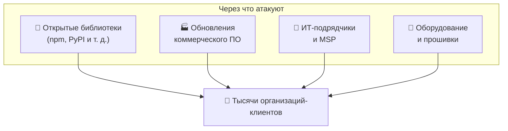

[🏠 Главная](../README.md) › [⚠️ Угрозы](README.md) › 📦 Атаки через цепочку поставок

# 📦 Атаки через цепочку поставок

**[Атака на цепочку поставок](../glossary.md#supply-chain-attack)** (supply chain attack) — атака не на саму жертву, а на того, кому она доверяет: разработчика программы, поставщика библиотеки, ИТ-подрядчика. Злоумышленник взламывает одного поставщика и через него получает доступ к тысячам его клиентов.

💡 Аналогия: чтобы отравить посетителей ресторана, не нужно проникать на кухню. Достаточно испортить продукты на складе поставщика.

> [!IMPORTANT]
> Опасность в том, что заражённое обновление приходит из **доверенного источника**, часто с настоящей цифровой подписью производителя. Защитные средства пропускают его как легитимное.

🏷️ **MITRE ATT&CK:** [T1195 Supply Chain Compromise](https://attack.mitre.org/techniques/T1195/) · [T1199 Trusted Relationship](https://attack.mitre.org/techniques/T1199/)

## Содержание

- [Виды атак](#виды-атак)
- [Реальные случаи](#реальные-случаи)
- [Как защититься](#как-защититься)
- [Источники](#источники)

---

## Виды атак

| Вид | ⚙️ Как работает | 🏷️ ATT&CK |
|---|---|---|
| **Заражение обновления** | Злоумышленник взламывает сборочную инфраструктуру производителя и встраивает бэкдор в официальное обновление | [T1195.002](https://attack.mitre.org/techniques/T1195/002/) |
| **Бэкдор в открытой библиотеке** | В популярный open-source проект встраивают вредоносный код: от имени взломанного или «втёршегося в доверие» мейнтейнера (сопровождающего проекта) | [T1195.001](https://attack.mitre.org/techniques/T1195/001/) |
| **[Тайпсквоттинг](../glossary.md#typosquatting)** (typosquatting) | Публикуют вредоносный пакет с названием, похожим на популярный: `reqeusts` вместо `requests`. Разработчик опечатывается и устанавливает его | [T1195.001](https://attack.mitre.org/techniques/T1195/001/) |
| **[Подмена зависимостей](../glossary.md#dependency-confusion)** (dependency confusion) | В публичный репозиторий выкладывают пакет с тем же именем, что у внутренней библиотеки компании, но с большим номером версии. Система сборки скачивает «свежую» публичную версию | [T1195.001](https://attack.mitre.org/techniques/T1195/001/) |
| **Атака через подрядчика** | Взламывают **[MSP](../glossary.md#msp)** (компанию, которая обслуживает ИТ клиентов) или подрядчика с удалённым доступом, а через него проникают к клиентам | [T1199](https://attack.mitre.org/techniques/T1199/) |
| **Аппаратная закладка** | Изменённое оборудование или прошивка ещё до поставки | [T1195.003](https://attack.mitre.org/techniques/T1195/003/) |
| **Уязвимая зависимость** | Не атака сама по себе: в популярной библиотеке находят уязвимость, и под угрозой оказываются все, кто её использует (Log4Shell) | [T1190](https://attack.mitre.org/techniques/T1190/) |

---

## Реальные случаи

### 📰 SolarWinds (2020): заражённое обновление

Злоумышленники проникли в инфраструктуру разработки компании SolarWinds и встроили бэкдор SUNBURST в обновления системы мониторинга Orion. По оценке самой SolarWinds, заражённое обновление могли установить менее 18 000 клиентов, среди них госведомства США. Затем атакующие выбрали небольшое число целей для дальнейшего шпионажа. Правительство США приписало атаку российской внешней разведке.
🔗 [CISA AA20-352A](https://www.cisa.gov/news-events/cybersecurity-advisories/aa20-352a) · [SolarWinds, отчёт 8-K в SEC](https://www.sec.gov/Archives/edgar/data/1739942/000162828020017451/swi-20201214.htm) · [CISA: Remediating Networks Affected by the SolarWinds and Active Directory/M365 Compromise](https://www.cisa.gov/news-events/news/remediating-networks-affected-solarwinds-and-active-directorym365-compromise)

### 📰 xz Utils (март 2024): бэкдор в открытом ПО

Человек под псевдонимом Jia Tan около двух лет вносил полезные изменения в проект xz Utils (утилита сжатия, которая есть почти в каждом Linux) и стал одним из его мейнтейнеров. Затем он встроил в версии 5.6.0 и 5.6.1 бэкдор, позволявший удалённо входить на серверы через SSH. Бэкдор случайно обнаружил разработчик Андрес Фройнд: он заметил, что вход по SSH стал медленнее на полсекунды. Заражённые версии не успели попасть в стабильные выпуски крупных дистрибутивов.
🔗 [NVD: CVE-2024-3094](https://nvd.nist.gov/vuln/detail/CVE-2024-3094) · [CISA Alert](https://www.cisa.gov/news-events/alerts/2024/03/29/reported-supply-chain-compromise-affecting-xz-utils-data-compression-library-cve-2024-3094) · [Сообщение Андреса Фройнда в рассылке oss-security](https://www.openwall.com/lists/oss-security/2024/03/29/4)

### 📰 Kaseya VSA (июль 2021): атака через MSP

Группировка REvil использовала уязвимость в системе удалённого управления Kaseya VSA, которой пользуются MSP-компании. Через MSP шифровальщик попал к их клиентам. По оценке Kaseya, пострадали около 60 её прямых клиентов и до 1500 их клиентов по всему миру.
🔗 [CISA: Kaseya VSA Supply-Chain Ransomware Attack](https://www.cisa.gov/news-events/news/kaseya-ransomware-attack-guidance-affected-msps-and-their-customers) · [Security Affairs: оценка Kaseya](https://securityaffairs.com/119759/cyber-crime/kaseya-attack-impacted-1500-businesses.html)

### 📰 Log4Shell (декабрь 2021): уязвимая зависимость

Критическая уязвимость в Log4j, популярной Java-библиотеке для ведения журналов. Она позволяла выполнить на сервере произвольный код, отправив ему особую строку текста. Log4j встроена в огромное число продуктов, и многие компании даже не знали, что используют её.
🔗 [NVD: CVE-2021-44228](https://nvd.nist.gov/vuln/detail/CVE-2021-44228) · [CISA: Apache Log4j Vulnerability Guidance](https://www.cisa.gov/news-events/news/apache-log4j-vulnerability-guidance)

### 📰 Dependency confusion (2021): исследование

Исследователь Алекс Бирсан показал, что так можно было выполнить свой код внутри более чем 35 компаний, включая Apple, Microsoft и PayPal. Он загрузил в публичные репозитории пакеты с именами их внутренних библиотек. Исследование проводилось в рамках программ bug bounty.
🔗 [Alex Birsan: Dependency Confusion](https://medium.com/@alex.birsan/dependency-confusion-4a5d60fec610)

---

## Как защититься

| 🛡️ Мера | 💡 Зачем |
|---|---|
| **[SBOM](../glossary.md#sbom)** (Software Bill of Materials, «состав» ПО: список всех компонентов) | Быстро понять, затронуты ли вы, когда находят новую уязвимость, как с Log4Shell |
| **Фиксировать версии зависимостей** и проверять их хеши | Защита от подмены и неожиданных «обновлений» |
| **Внутренний репозиторий пакетов** с проверенными версиями, явное указание источника для внутренних имён | Dependency confusion, тайпсквоттинг |
| **Сканировать зависимости на уязвимости** (**[SCA](../glossary.md#sca)**) | Уязвимые библиотеки |
| **Защищать собственную сборку**: MFA для разработчиков, подпись артефактов, фреймворк [SLSA](https://slsa.dev/) | Чтобы вы сами не стали «SolarWinds» для своих клиентов |
| **Минимальные права для подрядчиков**, доступ только на время работ, журналирование | Атаки через MSP и подрядчиков |
| **Следить за поведением доверенного ПО**: необычные сетевые соединения после обновления | Обнаружение заражённых обновлений |

[[CISA: Defending Against Software Supply Chain Attacks]](https://www.cisa.gov/resources-tools/resources/defending-against-software-supply-chain-attacks) · [[NIST SP 800-161 Rev. 1]](https://csrc.nist.gov/pubs/sp/800/161/r1/upd1/final)

---

## Источники

- [MITRE ATT&CK: T1195 Supply Chain Compromise](https://attack.mitre.org/techniques/T1195/)
- [MITRE ATT&CK: T1199 Trusted Relationship](https://attack.mitre.org/techniques/T1199/)
- [CISA AA20-352A: SolarWinds](https://www.cisa.gov/news-events/cybersecurity-advisories/aa20-352a)
- [SolarWinds Form 8-K (SEC, 14.12.2020)](https://www.sec.gov/Archives/edgar/data/1739942/000162828020017451/swi-20201214.htm)
- [NVD: CVE-2024-3094 (xz)](https://nvd.nist.gov/vuln/detail/CVE-2024-3094)
- [CISA: xz Utils](https://www.cisa.gov/news-events/alerts/2024/03/29/reported-supply-chain-compromise-affecting-xz-utils-data-compression-library-cve-2024-3094)
- [oss-security: backdoor in upstream xz/liblzma](https://www.openwall.com/lists/oss-security/2024/03/29/4)
- [CISA: Kaseya VSA](https://www.cisa.gov/news-events/news/kaseya-ransomware-attack-guidance-affected-msps-and-their-customers)
- [NVD: CVE-2021-44228 (Log4Shell)](https://nvd.nist.gov/vuln/detail/CVE-2021-44228)
- [Alex Birsan: Dependency Confusion](https://medium.com/@alex.birsan/dependency-confusion-4a5d60fec610)
- [CISA, NIST: Defending Against Software Supply Chain Attacks](https://www.cisa.gov/resources-tools/resources/defending-against-software-supply-chain-attacks)
- [NIST SP 800-161 Rev. 1](https://csrc.nist.gov/pubs/sp/800/161/r1/upd1/final)
- [SLSA: Supply-chain Levels for Software Artifacts](https://slsa.dev/)

---

[← 🕸️ Атаки на веб-приложения](05-web.md) · [🏠 Главная](../README.md) · [Далее: 🕵️ Внутренние угрозы →](07-insiders.md)

