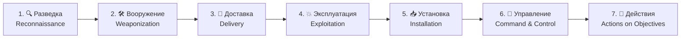

[🏠 Главная](../README.md) › [⚠️ Угрозы](README.md) › 🎯 Целевые атаки (APT)

# 🎯 Целевые атаки (APT)

**[APT](../glossary.md#apt)** (Advanced Persistent Threat, «продвинутая постоянная угроза») — группировка с большими ресурсами, обычно связанная с государством. Она атакует конкретную организацию ради долгосрочной цели: шпионажа, диверсии, кражи технологий.

Расшифровка названия:
- **Advanced (продвинутая).** У группировки есть собственные инструменты, а иногда и уязвимости нулевого дня.
- **Persistent (постоянная).** Группировка месяцами и годами незаметно остаётся в сети жертвы.
- **Threat (угроза).** У неё есть цель, мотивация и ресурсы.

[[NIST Glossary: APT]](https://csrc.nist.gov/glossary/term/advanced_persistent_threat)

## Содержание

- [Чем APT отличается от обычной атаки](#чем-apt-отличается-от-обычной-атаки)
- [Модель Cyber Kill Chain](#модель-cyber-kill-chain)
- [Матрица MITRE ATT&CK](#матрица-mitre-attck)
- [Как называют группировки](#как-называют-группировки)
- [Реальные случаи](#реальные-случаи)
- [Как защититься](#как-защититься)
- [Источники](#источники)

---

## Чем APT отличается от обычной атаки

| | 🎲 Массовая атака | 🎯 APT |
|---|---|---|
| **Цель** | Кто попадётся | Конкретная организация |
| **Мотив** | Быстрые деньги | Шпионаж, диверсия, стратегическая выгода |
| **Длительность** | Часы или дни | Месяцы и годы |
| **Скрытность** | Не важна (шифровальщик сам себя выдаёт) | Главный приоритет |
| **Инструменты** | Готовые | Свои, плюс **[«жизнь за счёт системы»](../glossary.md#lotl)** (Living off the Land): использование встроенных средств ОС вместо вредоносов |

---

## Модель Cyber Kill Chain

Модель компании Lockheed Martin (2011) описывает атаку как цепочку из 7 звеньев. Главная мысль: **если разорвать любое звено, атака сорвётся**. [[Lockheed Martin: Cyber Kill Chain]](https://www.lockheedmartin.com/en-us/capabilities/cyber/cyber-kill-chain.html)

| # | Этап | 💡 Что происходит | Пример |
|:-:|---|---|---|
| 1 | Разведка | Сбор информации о жертве | Изучение сотрудников в соцсетях, сканирование серверов |
| 2 | Вооружение | Подготовка «оружия» | Документ с эксплойтом внутри |
| 3 | Доставка | Передача «оружия» жертве | Целевое фишинговое письмо |
| 4 | Эксплуатация | Срабатывание уязвимости | Жертва открывает документ, срабатывает эксплойт |
| 5 | Установка | Закрепление в системе | Установка бэкдора |
| 6 | Управление ([C2](../glossary.md#c2)) | Канал связи с атакующим | Бэкдор «звонит домой» на сервер злоумышленника |
| 7 | Действия | Достижение цели | Кража документов, уничтожение данных |

---

## Матрица MITRE ATT&CK

**[MITRE ATT&CK](../glossary.md#mitre-attack)** (Adversarial Tactics, Techniques, and Common Knowledge) — открытая и постоянно обновляемая база знаний о реальном поведении атакующих. Сейчас это главный «общий язык» специалистов по защите во всём мире. [[MITRE ATT&CK]](https://attack.mitre.org/)

Устройство матрицы:
- **Тактика** — *зачем* атакующий что-то делает на этом шаге (цель этапа).
- **Техника** — *как* он этого добивается. У каждой техники есть номер вида `T1566`.
- **[TTP](../glossary.md#ttp)** (Tactics, Techniques, Procedures) — характерный «почерк» группировки.

### 14 тактик Enterprise ATT&CK

| ID | Тактика | 💡 Цель атакующего |
|:-:|---|---|
| [TA0043](https://attack.mitre.org/tactics/TA0043/) | Reconnaissance — разведка | Собрать информацию о цели |
| [TA0042](https://attack.mitre.org/tactics/TA0042/) | Resource Development — подготовка ресурсов | Купить домены, серверы, инструменты |
| [TA0001](https://attack.mitre.org/tactics/TA0001/) | Initial Access — первоначальный доступ | Попасть внутрь |
| [TA0002](https://attack.mitre.org/tactics/TA0002/) | Execution — выполнение | Запустить свой код |
| [TA0003](https://attack.mitre.org/tactics/TA0003/) | Persistence — закрепление | Остаться после перезагрузки и смены паролей |
| [TA0004](https://attack.mitre.org/tactics/TA0004/) | Privilege Escalation — повышение привилегий | Получить права администратора |
| [TA0005](https://attack.mitre.org/tactics/TA0005/) | Stealth — скрытность (раньше называлась Defense Evasion) | Не попасться средствам защиты |
| [TA0006](https://attack.mitre.org/tactics/TA0006/) | Credential Access — доступ к учётным данным | Украсть пароли и токены |
| [TA0007](https://attack.mitre.org/tactics/TA0007/) | Discovery — исследование | Понять, как устроена сеть |
| [TA0008](https://attack.mitre.org/tactics/TA0008/) | Lateral Movement — **[горизонтальное перемещение](../glossary.md#lateral-movement)** | Перейти с одного компьютера на другие |
| [TA0009](https://attack.mitre.org/tactics/TA0009/) | Collection — сбор | Собрать нужные данные |
| [TA0011](https://attack.mitre.org/tactics/TA0011/) | Command and Control — управление | Поддерживать связь с заражёнными машинами |
| [TA0010](https://attack.mitre.org/tactics/TA0010/) | Exfiltration — **[эксфильтрация](../glossary.md#exfiltration)** | Вывести данные наружу |
| [TA0040](https://attack.mitre.org/tactics/TA0040/) | Impact — воздействие | Зашифровать, уничтожить, нарушить работу |

[[MITRE ATT&CK: Enterprise Tactics]](https://attack.mitre.org/tactics/enterprise/)

> [!TIP]
> Чтобы увидеть матрицу целиком и отметить, от каких техник вы уже защищены, используйте бесплатный инструмент [ATT&CK Navigator](https://mitre-attack.github.io/attack-navigator/).

### IoC и TTP: почему поведение важнее «отпечатков»

**[IoC](../glossary.md#ioc)** (Indicator of Compromise, индикатор компрометации) — «улика» атаки: хеш вредоносного файла, IP-адрес, домен. Атакующему легко их сменить. **TTP** (поведение) сменить намного сложнее. На этом построена «Пирамида боли» Дэвида Бьянко: чем выше уровень индикатора, тем дороже атакующему его изменить. [[David Bianco: The Pyramid of Pain]](https://detect-respond.blogspot.com/2013/03/the-pyramid-of-pain.html)

---

## Как называют группировки

У одной и той же группировки бывает много названий, потому что каждая компания-исследователь даёт свои имена. Например, группировку, которую MITRE обозначает **APT28** ([G0007](https://attack.mitre.org/groups/G0007/)), также называют Fancy Bear, Sofacy, Forest Blizzard. Каталог группировок с псевдонимами ведёт MITRE. [[MITRE ATT&CK: Groups]](https://attack.mitre.org/groups/)

---

## Реальные случаи

### 📰 Операция «Триангуляция» (2023): атака на iPhone без участия пользователя

«Лаборатория Касперского» обнаружила, что iPhone её сотрудников заражены через iMessage. Для заражения не требовалось никаких действий пользователя (**[zero-click](../glossary.md#zero-click)**). Атака использовала цепочку из нескольких уязвимостей нулевого дня в iOS, в том числе в аппаратных механизмах защиты.
🔗 [Securelist: Operation Triangulation](https://securelist.ru/operation-triangulation/107001/) · [Securelist: The last (?) secret of Operation Triangulation](https://securelist.com/operation-triangulation-the-last-hardware-mystery/111669/)

### 📰 Volt Typhoon (2023–2024): «жизнь за счёт системы»

По данным CISA, NSA и FBI, связанная с Китаем группировка годами скрытно находилась в сетях критической инфраструктуры США: энергетики, водоснабжения, транспорта. Она почти не использовала вредоносы, только встроенные инструменты Windows. Власти США оценили цель как подготовку к возможным диверсиям.
🔗 [CISA AA24-038A](https://www.cisa.gov/news-events/cybersecurity-advisories/aa24-038a)

### 📰 Энергосистема Украины (декабрь 2015)

Первая публично подтверждённая кибератака, которая отключила электричество. Злоумышленники проникли в сети нескольких энергокомпаний через фишинг, а затем удалённо отключили подстанции. Без света остались около 225 000 потребителей.
🔗 [CISA ICS Alert IR-ALERT-H-16-056-01](https://www.cisa.gov/news-events/ics-alerts/ir-alert-h-16-056-01)

---

## Как защититься

| 🛡️ Мера | 💡 Суть |
|---|---|
| **Исходить из того, что взлом уже произошёл** (assume breach) | Искать атакующего внутри, а не только охранять периметр |
| **[EDR](../glossary.md#edr)** и централизованный сбор журналов в **[SIEM](../glossary.md#siem)** | Видеть подозрительное поведение на компьютерах и в сети |
| **[Threat hunting](../glossary.md#threat-hunting)** (проактивный поиск угроз) | Специалисты сами ищут следы атакующих, не дожидаясь тревоги |
| **Сопоставлять защиту с ATT&CK** | Понимать, какие техники вы обнаруживаете, а какие нет |
| **Защищать привилегированные учётные записи**: отдельные админские учётки, MFA, **[PAM](../glossary.md#pam)** | Без прав администратора атакующий далеко не продвинется |
| **Сегментация сети** | Затрудняет горизонтальное перемещение |
| **Контроль исходящего трафика** | Мешает связи с сервером C2 и выводу данных |
| **[Threat Intelligence](../glossary.md#threat-intelligence)** (разведданные об угрозах) | Знать, кто атакует вашу отрасль и какими методами |

---

## Источники

- [NIST Glossary: Advanced Persistent Threat](https://csrc.nist.gov/glossary/term/advanced_persistent_threat)
- [Lockheed Martin: Cyber Kill Chain](https://www.lockheedmartin.com/en-us/capabilities/cyber/cyber-kill-chain.html)
- [MITRE ATT&CK](https://attack.mitre.org/)
- [MITRE ATT&CK: Enterprise Tactics](https://attack.mitre.org/tactics/enterprise/)
- [MITRE ATT&CK: Groups](https://attack.mitre.org/groups/)
- [MITRE ATT&CK Navigator](https://mitre-attack.github.io/attack-navigator/)
- [David Bianco: The Pyramid of Pain](https://detect-respond.blogspot.com/2013/03/the-pyramid-of-pain.html)
- [Securelist: Operation Triangulation (рус.)](https://securelist.ru/operation-triangulation/107001/)
- [CISA AA24-038A: Volt Typhoon](https://www.cisa.gov/news-events/cybersecurity-advisories/aa24-038a)
- [CISA ICS Alert: Cyber-Attack Against Ukrainian Critical Infrastructure](https://www.cisa.gov/news-events/ics-alerts/ir-alert-h-16-056-01)

---

[← 🕵️ Внутренние угрозы](07-insiders.md) · [🏠 Главная](../README.md) · [Далее: ☁️ Угрозы в облаке →](09-cloud.md)

