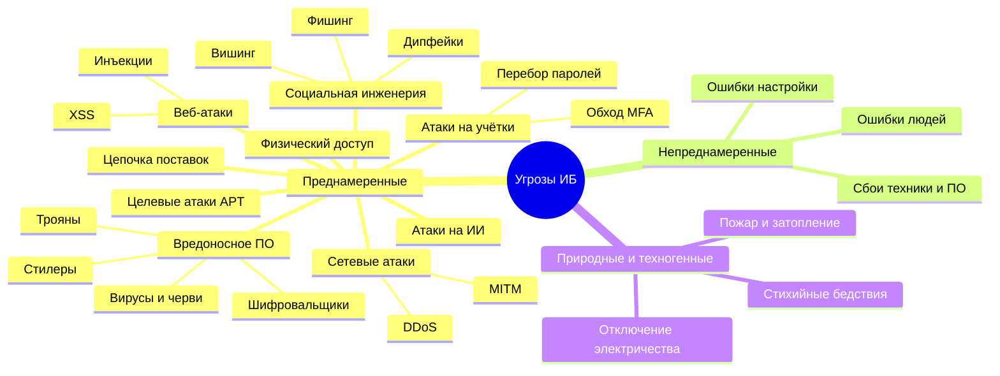

[🏠 Главная](../README.md) › ⚠️ Угрозы

# ⚠️ Угрозы информационной безопасности

> [!TIP]
> Если вы только начинаете, сначала прочитайте [🧭 Базовые понятия](00-basics.md). Там объясняется, чем угроза отличается от уязвимости и риска.

## Содержание

- [Что такое угроза](#что-такое-угроза)
- [Карта угроз](#карта-угроз)
- [Как классифицируют угрозы](#как-классифицируют-угрозы)
- [Все разделы](#все-разделы)
- [Что сейчас актуально](#что-сейчас-актуально)
- [Источники](#источники)

---

## Что такое угроза

**[Угроза](../glossary.md#threat)** — это то, что *может* причинить вред информации или системе: украсть данные, испортить их или сделать недоступными.

Угроза ещё не означает, что вред случится. Она реализуется, только если найдёт **[уязвимость](../glossary.md#vulnerability)** (слабое место). Пример: вор (угроза) проникает через незапертую дверь (уязвимость).

Официальное определение по ГОСТ Р 50922-2006: угроза безопасности информации — это *совокупность условий и факторов, создающих потенциальную или реально существующую опасность нарушения безопасности информации*. [[ГОСТ Р 50922-2006]](https://docs.cntd.ru/document/1200058320)

---

## Карта угроз

---

## Как классифицируют угрозы

Единой классификации нет. Угрозы раскладывают по разным признакам, и каждый признак помогает ответить на свой вопрос.

### 1. По источнику: *кто или что угрожает?*

| Тип | Что это | Примеры |
|---|---|---|
| 👤 **Антропогенные** (от людей) | Действия человека, умышленные или случайные | Хакер, мошенник, неаккуратный сотрудник |
| ⚙️ **Техногенные** (от техники) | Отказы оборудования, ПО, инфраструктуры | Сгорел диск, сбойное обновление, авария электросети |
| 🌪️ **Природные** (стихийные) | События, которые не зависят от людей | Наводнение, землетрясение, удар молнии |

Близкое деление закреплено в ГОСТ Р 51275-2006. По природе возникновения он делит факторы, воздействующие на информацию, на **объективные** и **субъективные**, а внутри них выделяет **внутренние** и **внешние**. [[ГОСТ Р 51275-2006]](https://docs.cntd.ru/document/1200057516)

### 2. По умыслу: *хотел ли кто-то навредить?*

- **Преднамеренные.** Вред причиняют специально: взлом, кража, саботаж.
- **Непреднамеренные (случайные).** Вред возникает по ошибке: письмо отправили не тому адресату, удалили не тот файл, неправильно настроили сервер.

### 3. По расположению источника: *откуда угроза?*

- **Внешние.** Угроза идёт извне: хакеры, конкуренты, спецслужбы других стран.
- **Внутренние.** Угроза исходит от своих: сотрудники, подрядчики, бывшие работники. Подробнее в разделе [🕵️ Внутренние угрозы](07-insiders.md).

### 4. По нарушаемому свойству: *что именно пострадает?*

Это классика ИБ, так называемая **[триада CIA](../glossary.md#cia)**:

| Свойство | Что значит | Угроза, которая его нарушает |
|---|---|---|
| 🔒 **Конфиденциальность** (Confidentiality) | Информацию видят только те, кому можно | Утечка, кража, подслушивание |
| ✅ **Целостность** (Integrity) | Информация не искажена | Подмена платёжных реквизитов, порча базы данных |
| ⏱️ **Доступность** (Availability) | Информация доступна, когда она нужна | DDoS, шифровальщик, отказ сервера |

[[NIST SP 800-12 Rev. 1]](https://csrc.nist.gov/pubs/sp/800/12/r1/final)

### 5. По модели STRIDE: *что может сделать злоумышленник?*

STRIDE придумали в Microsoft для **[моделирования угроз](../glossary.md#threat-modeling)**, то есть заранее продуманного поиска того, что может пойти не так. Название составлено из первых букв шести типов угроз. [[Microsoft Learn]](https://learn.microsoft.com/en-us/azure/security/develop/threat-modeling-tool-threats)

| Буква | Угроза | Простыми словами | Что нарушается |
|:-:|---|---|---|
| **S** | Spoofing (подмена) | Выдать себя за другого | Подлинность |
| **T** | Tampering (изменение) | Тайно изменить данные | Целостность |
| **R** | Repudiation (отказ) | Сделать что-то и отпереться, потому что нет следов | Неотказуемость |
| **I** | Information disclosure (раскрытие) | Узнать то, что не положено | Конфиденциальность |
| **D** | Denial of service (отказ в обслуживании) | Сломать или перегрузить сервис | Доступность |
| **E** | Elevation of privilege (повышение привилегий) | Получить больше прав, чем выдано | Авторизация |

### 6. По этапам атаки: *что делает злоумышленник шаг за шагом?*

Матрица **[MITRE ATT&CK](../glossary.md#mitre-attack)** — это открытая база знаний о поведении реальных атакующих. Она делит атаку на 14 **тактик** (целей на каждом этапе). Подробнее в разделе [🎯 Целевые атаки](08-apt.md). [[MITRE ATT&CK]](https://attack.mitre.org/tactics/enterprise/)

### 7. Официальный российский каталог: Банк данных угроз ФСТЭК

**ФСТЭК России** (Федеральная служба по техническому и экспортному контролю, регулятор в области защиты информации) ведёт **Банк данных угроз безопасности информации (БДУ)**. В нём собраны угрозы с идентификаторами вида `УБИ.001` и уязвимости. На БДУ опирается официальная «Методика оценки угроз безопасности информации» (2021), по которой российские организации составляют **[модель угроз](../glossary.md#threat-model)**. [[БДУ ФСТЭК]](https://bdu.fstec.ru/threat) · [[Методика ФСТЭК 2021]](https://www.consultant.ru/document/cons_doc_LAW_378330/)

---

## Все разделы

| # | Раздел | Главные угрозы | Что чаще всего нарушается |
|:-:|---|---|:-:|
| 0 | [🧭 Базовые понятия](00-basics.md) | — | — |
| 1 | [🦠 Вредоносное ПО](01-malware.md) | Шифровальщики, стилеры, ботнеты | 🔒 ✅ ⏱️ |
| 2 | [🎣 Социальная инженерия](02-social-engineering.md) | Фишинг, BEC, дипфейки | 🔒 |
| 3 | [🔑 Атаки на учётные записи](03-credentials.md) | Credential stuffing, обход MFA | 🔒 ✅ |
| 4 | [🌐 Сетевые атаки](04-network.md) | DDoS, MITM, DNS-спуфинг | ⏱️ 🔒 |
| 5 | [🕸️ Атаки на веб-приложения](05-web.md) | Инъекции, нарушение контроля доступа | 🔒 ✅ |
| 6 | [📦 Цепочка поставок](06-supply-chain.md) | Заражённые обновления и библиотеки | 🔒 ✅ ⏱️ |
| 7 | [🕵️ Внутренние угрозы](07-insiders.md) | Кража данных сотрудниками, ошибки | 🔒 ✅ |
| 8 | [🎯 Целевые атаки (APT)](08-apt.md) | Кибершпионаж, диверсии | 🔒 ✅ ⏱️ |
| 9 | [☁️ Облако](09-cloud.md) | Ошибки настройки, утечки ключей | 🔒 |
| 10 | [📱 Мобильные и IoT](10-mobile-iot.md) | Шпионские программы, IoT-ботнеты | 🔒 ⏱️ |
| 11 | [🤖 ИИ](11-ai.md) | Prompt injection, дипфейки | 🔒 ✅ |
| 12 | [🚪 Физические угрозы](12-physical.md) | Проход в офис, флешки, кража ноутбуков | 🔒 ✅ ⏱️ |
| 13 | [🌪️ Непреднамеренные угрозы](13-non-malicious.md) | Ошибки, сбои, стихийные бедствия | ✅ ⏱️ |

🔒 конфиденциальность · ✅ целостность · ⏱️ доступность

---

## Что сейчас актуально

Коротко, по ежегодным отчётам крупных организаций:

- **ENISA Threat Landscape 2025** (агентство ЕС по кибербезопасности). Отчёт проанализировал 4875 инцидентов с июля 2024 по июнь 2025:
  - 77% инцидентов — DDoS-атаки, в основном со стороны **[хактивистов](../glossary.md#hacktivism)**;
  - самая разрушительная угроза — **шифровальщики**;
  - главный способ проникновения — **фишинг** (около 60% случаев), второй — эксплуатация уязвимостей (21,3%);
  - злоумышленники всё активнее используют ИИ для фишинга и социальной инженерии;
  - границы между киберпреступниками, государственными группировками и хактивистами размываются.

  [[ENISA ETL 2025]](https://www.enisa.europa.eu/publications/enisa-threat-landscape-2025) · [[Пресс-релиз ENISA]](https://www.enisa.europa.eu/news/etl-2025-eu-consistently-targeted-by-diverse-yet-convergent-threat-groups)
- **Verizon DBIR 2026** (ежегодный отчёт о расследованиях утечек). Впервые за всю историю отчёта главным способом первоначального проникновения стала **эксплуатация уязвимостей**, то есть использование ошибок в ПО. Она обошла кражу учётных данных. [[Verizon DBIR]](https://www.verizon.com/business/resources/reports/dbir/) · [[Help Net Security, обзор DBIR 2026]](https://www.helpnetsecurity.com/2026/05/25/lessons-from-verizon-dbir-2026-findings/)

> [!NOTE]
> Цифры в отчётах сильно зависят от методики и выборки. Отчёты разных организаций нельзя сравнивать напрямую: у ENISA на первом месте DDoS, у Verizon — утечки данных.

---

## Источники

- [ГОСТ Р 50922-2006. Защита информации. Основные термины и определения](https://docs.cntd.ru/document/1200058320)
- [ГОСТ Р 51275-2006. Факторы, воздействующие на информацию](https://docs.cntd.ru/document/1200057516)
- [Банк данных угроз ФСТЭК России](https://bdu.fstec.ru/threat)
- [Методика оценки угроз безопасности информации, ФСТЭК России, 05.02.2021](https://www.consultant.ru/document/cons_doc_LAW_378330/)
- [NIST SP 800-12 Rev. 1. An Introduction to Information Security](https://csrc.nist.gov/pubs/sp/800/12/r1/final)
- [Microsoft. Threat Modeling Tool: STRIDE](https://learn.microsoft.com/en-us/azure/security/develop/threat-modeling-tool-threats)
- [MITRE ATT&CK. Enterprise Tactics](https://attack.mitre.org/tactics/enterprise/)
- [ENISA Threat Landscape 2025](https://www.enisa.europa.eu/publications/enisa-threat-landscape-2025)
- [Verizon Data Breach Investigations Report](https://www.verizon.com/business/resources/reports/dbir/)

---

[🏠 Главная](../README.md) · [Далее: 🧭 Базовые понятия →](00-basics.md)

